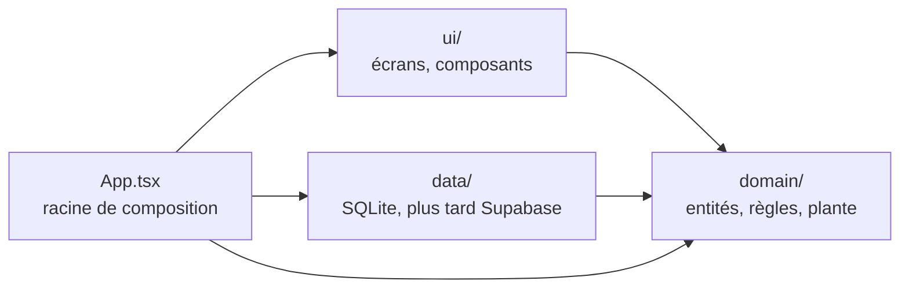

# Architecture

Ce document décrit comment le code est organisé et pourquoi. Les raisons des
choix de stack sont dans [l'ADR 0001](decisions/0001-stack-et-architecture.md).

## Le produit en une phrase

L'utilisateur suit des habitudes qu'il veut **arrêter** (« jours sans fumer »).
Le compteur avance tout seul avec le temps ; le seul événement saisi est une
**rechute**. Chaque habitude est une plante en pixel art qui pousse jour après
jour. Une rechute la fait mourir ; on replante une nouvelle plante, et les
vies passées restent visibles dans l'herbier ([ADR 0013](decisions/0013-la-plante-meurt.md)).

L'app se veut un **compagnon de poche, doux et sans jugement**. Chaque habitude
est une plante d'intérieur posée sur une étagère ; on veut que les gens aient
envie de collectionner les plantes.

## Principes du produit

Ces principes priment sur toute idée de fonctionnalité. Une proposition qui en
contredit un est refusée ou retravaillée.

- **La plante meurt quand l'habitude échoue ; on peut toujours replanter.**
  (Ce principe remplace « la plante ne meurt jamais », ADR 0013.)
- **Aucun message culpabilisant, aucune notification de reproche.** Une
  plante morte se dit « Elle n'a pas tenu cette fois. Tu peux replanter. »,
  sans rouge.
- **Une vie passée reste visible**, dans l'herbier et dans le journal.
- **Écrire une note est toujours facultatif.**

Les idées notées pour plus tard sont dans [idees.md](idees.md).

## Les trois couches



| Couche    | Contient                                                                                | Peut importer              |
| --------- | --------------------------------------------------------------------------------------- | -------------------------- |
| `domain/` | Entités, règles métier, générateur de plante, interfaces de repository. TypeScript pur. | rien d'autre que `domain/` |
| `data/`   | Implémentations des repositories (expo-sqlite aujourd'hui, Supabase plus tard).         | `domain/`                  |
| `ui/`     | Écrans et composants. Ils affichent et délèguent, ils ne calculent pas.                 | `domain/`                  |

### La règle de dépendance : `ui -> domain <- data`

Les flèches pointent vers le domaine : c'est lui qui contient ce qui a de la
valeur (les règles), et il ne doit dépendre d'aucun détail technique. On peut
alors :

- **tester** tout le domaine avec Jest, sans téléphone, sans base de données ;
- **remplacer** SQLite par Supabase (ou les deux) sans toucher une ligne du
  domaine ;
- **changer** l'interface graphique sans risquer de casser une règle métier.

### Comment `data/` peut dépendre du domaine et pas l'inverse

C'est l'**inversion de dépendance**. Le domaine déclare ce dont il a besoin
sous forme d'interface, par exemple :

```ts
// src/domain/… (prévu, pas encore écrit)
export interface RelapseRepository {
  listByHabit(habitId: HabitId): Promise<Relapse[]>;
  add(relapse: Relapse): Promise<void>;
}
```

`data/` fournit une classe qui **implémente** cette interface avec SQLite. Le
domaine ne connaît que l'interface ; il ne sait pas qu'SQLite existe.

### La racine de composition

Quelqu'un doit bien créer l'implémentation SQLite et la donner à l'interface
graphique. Ce rôle revient à `App.tsx`, à la racine du projet, hors des trois
couches : c'est le **seul** endroit autorisé à importer `ui/`, `domain/` et
`data/` à la fois. `ui/` n'importe donc jamais `data/` directement.

### Vérification automatique

La règle n'est pas qu'une convention : `npm run lint` échoue si elle est
violée (voir `eslint.config.js`).

- `import/no-restricted-paths` interdit `domain -> data`, `domain -> ui`,
  `data -> ui` et `ui -> data`.
- `no-restricted-imports` interdit à `domain/` d'importer React, React Native,
  Expo, Zustand, Skia ou Supabase.

## Modèle de données

Les entités principales sont dans `src/domain/habit.ts`, `src/domain/relapse.ts`
et `src/domain/lives.ts`. Les notes et les arrosages sont décrits dans
[l'ADR 0009](decisions/0009-notes-et-arrosage.md), le statut d'une habitude
dans [l'ADR 0011](decisions/0011-retirer-et-effacer.md), les vies dans
[l'ADR 0013](decisions/0013-la-plante-meurt.md).

```ts
type HabitId = string; // UUID
type LocalDate = string; // 'YYYY-MM-DD', jour calendaire local

interface Habit {
  id: HabitId;
  name: string;
  seed: number; // entier 32 bits, tiré une seule fois à la création
  species: string; // espèce de la plante, ex. 'monstera' (voir plus bas)
  startDate: LocalDate; // premier jour du suivi, startDate <= aujourd'hui
  createdAt: string; // instant ISO 8601 UTC
  status: 'shelf' | 'garden' | 'given'; // garden : dans l'herbier
  retiredOn: LocalDate | null; // jour où elle a quitté l'étagère
  updatedAt: string;
  deletedAt: string | null; // effacée : il n'en reste qu'une trace
}

interface Relapse {
  id: string; // UUID déterministe, calculé à partir de (habitId, date)
  habitId: HabitId;
  date: LocalDate; // startDate <= date <= aujourd'hui
  deletedAt: string | null; // instant ISO 8601 UTC si la rechute est annulée
  updatedAt: string; // instant ISO 8601 UTC de la dernière modification
}
// Unicité : une seule rechute par (habitId, date), lignes annulées comprises.

interface Replanting {
  id: string; // UUID déterministe, calculé à partir de (habitId, date)
  habitId: HabitId;
  date: LocalDate; // le jour où une plante morte a été replantée
  updatedAt: string;
}
// Les vies (et la mort de chaque plante) sont calculées à partir des
// rechutes et des replantations ; elles ne sont jamais stockées.
```

### L'espèce de la plante (`Habit.species`)

- Une nouvelle habitude reçoit une espèce **connue** du registre (13 espèces).
  En attendant l'écran de choix, elle est tirée au hasard avec le générateur
  injecté.
- **Espèce inconnue à la lecture : plante de remplacement, jamais d'erreur.**
  Un appareil pas à jour pourra recevoir par synchronisation une espèce ajoutée
  dans une version plus récente. L'écran ne doit pas planter pour ça : le
  générateur dessine l'espèce de remplacement (`FALLBACK_SPECIES_ID`,
  aujourd'hui le monstera) et le signale (`PlantImage.fallback`). Quand l'app
  sera mise à jour, la vraie plante apparaîtra.
- **Inconvénient évité :** si le remplacement était fait au moment de la
  lecture, la prochaine sauvegarde de l'habitude écraserait la vraie espèce,
  et la synchronisation propagerait l'erreur. `Habit.species` garde donc la
  valeur brute lue en base ; le remplacement n'a lieu qu'au dessin.
- **Migration SQLite n°2** : `ALTER TABLE habits ADD COLUMN species TEXT NOT
NULL DEFAULT 'monstera'`, puis répartition des habitudes existantes sur les
  quatre espèces selon `seed % 4`. SQLite exige un `DEFAULT` pour ajouter une
  colonne `NOT NULL` à une table non vide. Vérifié : `seed` est bien stocké
  comme entier (affinité `INTEGER`, même si le pilote l'envoie en flottant), et
  la migration ajoute un `CAST` par sécurité.

### Règles sur l'habitude

- **`startDate` jamais dans le futur, mais librement dans le passé.** On peut
  déclarer un arrêt commencé il y a plusieurs semaines : la plante naît alors
  avec toutes ces semaines déjà poussées. Comme la validation des rechutes,
  cette règle du domaine reçoit `today` en paramètre.

### Règles sur les rechutes

- **Une seule rechute par jour et par habitude**, garantie par une contrainte
  d'unicité sur `(habitId, date)`. Saisir une rechute un jour qui en a déjà
  une active ne fait rien : l'opération est idempotente, on peut la rejouer
  sans risque.

- **Saisie rétroactive autorisée**, pour n'importe quel jour entre `startDate`
  et aujourd'hui inclus. **Jamais dans le futur.** La validation est une règle
  du domaine : elle reçoit `today` en paramètre, comme le générateur.
- **Annulation par suppression logique.** Annuler une rechute renseigne
  `deletedAt` ; la ligne n'est jamais effacée. Toutes les lectures métier
  ignorent les rechutes dont `deletedAt` n'est pas `null`.
- **Pourquoi pas une vraie suppression :** avec la synchronisation, un appareil
  qui ne voit plus une ligne ne sait pas si elle a été supprimée ailleurs ou si
  elle n'a jamais existé. Une suppression logique est une donnée comme une
  autre : synchroniser revient à fusionner des lignes, sans cas particulier.

### Unicité et suppression logique ensemble

- **L'unicité porte sur toutes les lignes, annulées comprises.** Sinon une
  ligne annulée et une ligne active pourraient coexister pour le même jour.
- **Ressaisir une rechute annulée la réactive** (`deletedAt` repasse à
  `null`) au lieu de créer une ligne. On peut ainsi revenir sur une annulation
  faite par erreur.
- **L'identifiant d'une rechute est déterministe**, calculé à partir de
  `habitId` et `date`. Deux appareils hors ligne qui enregistrent la même
  rechute produisent le même `id` ; la fusion retombe sur « même ligne », sans
  conflit d'unicité à résoudre.
- **`updatedAt` est renseigné à chaque changement d'état** (création,
  annulation, réactivation), avec l'horloge injectée. Une saisie sans effet
  (rechute déjà active) ne le modifie pas. Lors de la synchronisation, pour une
  même ligne, la version au `updatedAt` le plus récent gagne.
- **Limite connue :** « le plus récent gagne » se fie à l'horloge de chaque
  appareil. Une horloge déréglée peut faire gagner une action plus ancienne.
  Acceptable pour une app personnelle ; à revoir si la synchronisation devient
  collaborative.

### Choix et raisons

- **UUID générés sur l'appareil**, pas d'auto-incrément SQLite. Avec la
  synchronisation, deux appareils créeront des objets hors ligne ; deux
  auto-incréments donneraient le même `1`.
- **`LocalDate` pour `startDate` et `Relapse.date`.** « J'ai rechuté mardi » est
  un jour du calendrier, pas un instant. Un timestamp UTC ferait glisser une
  rechute de 23 h vers le lendemain selon le fuseau horaire.
- **`createdAt` reste un instant**, car c'est un fait technique (quand la ligne
  a été créée), pas une notion métier. `startDate` et `createdAt` peuvent
  différer : on peut commencer à suivre une habitude arrêtée il y a 10 jours.
- **La série courante n'est pas stockée.** Elle se calcule à partir de
  `startDate`, des rechutes et de la date du jour. Ne stocker que les faits
  évite qu'un compteur et l'historique se contredisent.
- **Pas de `CheckIn`.** Dans une habitude à arrêter, un jour sans événement est
  un jour réussi : il n'y a rien à cocher.

## La plante : une fonction pure

```
plante = f(vie, aujourd'hui)      // vie : graine, premier jour, fin
```

Depuis l'ADR 0013, une habitude a des **vies** successives (`splitLives`,
`lives.ts`) : chaque rechute termine la vie en cours, « Replanter » en ouvre
une nouvelle avec une graine tirée de `(habitId, date)`. La plante dessinée
est celle de la vie en cours (morte si une rechute l'a terminée). Tout ce
qui suit vaut **à l'intérieur d'une vie** ; la graine et le jour 1 sont ceux
de la vie. Rien de cela n'est stocké : supprimer une rechute ranime la
plante.

Le générateur, dans `domain/`, renvoie une **description** de la plante (une
grille de pixels, ou une liste d'éléments positionnés), pas une image. `ui/` la
dessine avec react-native-skia. Le domaine ne sait rien de Skia.

### Pourquoi une fonction pure

Une fonction pure renvoie toujours le même résultat pour les mêmes entrées et ne
lit rien d'autre que ses paramètres.

- **Rien à stocker.** On ne sauvegarde jamais d'image ; la plante se recalcule
  à chaque affichage. Pas de fichier à gérer, rien à migrer.
- **Rien à synchroniser.** Plus tard, pour que la plante soit identique sur
  deux appareils, il suffit de synchroniser `seed`, `startDate` et les rechutes.
- **Testable.** On fixe les entrées, on vérifie la sortie. Pas de mock d'écran.
- **Unique.** Le `seed` rend chaque plante différente, de façon reproductible.

### Ce qu'on injecte, et pourquoi

Une fonction pure ne peut pas appeler `Date.now()` ni `Math.random()` : ce
serait lire un état caché, et le résultat changerait d'un appel à l'autre.

- **La date du jour** est un paramètre (`today: LocalDate`). En test, on simule
  « dans 30 jours » en passant une autre date.
- **L'aléatoire** ne sert qu'une fois : tirer le `seed` à la création de
  l'habitude. Le générateur de nombres aléatoires est injecté dans la fonction
  de création, ce qui permet un seed fixe en test. Ensuite, toute la
  « variété » de la plante vient d'un générateur pseudo-aléatoire **déterministe**
  initialisé avec ce `seed`.

### Contrainte : la croissance se fait par ajout seulement

Chaque jour depuis `startDate` a une **position stable** dans la plante. Ce qui
a déjà poussé ne bouge plus jamais : demain, on ajoute ; on ne redessine pas.

Le générateur sépare deux choses :

- **La géométrie** (où se trouve chaque jour) dépend **seulement** de `seed`
  et de l'index du jour `n` (nombre de jours depuis `startDate`). Les rechutes
  ne la modifient jamais.
- **L'apparence** de la case du jour `n` dépend de `seed`, de `n` et du fait
  qu'il y ait ou non une rechute active **ce jour-là uniquement**. Comme il y a
  au plus une rechute par jour, c'est un simple booléen.

```
position(n)   = g(seed, n)
apparence(n)  = h(seed, n, rechuteLeJour(n))   // rechuteLeJour : booléen
plante        = [ (position(n), apparence(n)) pour n de 0 à index(aujourd'hui) ]
```

`aujourd'hui` sert seulement à savoir **jusqu'où** dessiner.

Pourquoi ce découpage :

- **La saisie et l'annulation rétroactives sont sûres.** Ajouter ou annuler une
  rechute pour le jour `n` ne change que la case `n`. Rien d'autre ne bouge,
  ni avant, ni après.
- **Les notes datées pourront s'accrocher** à `position(n)` sans jamais être
  déplacées.
- **Propriétés testables**, qui seront les tests clés du générateur :
  - la plante d'aujourd'hui est un **préfixe** de la plante de demain ;
  - ajouter ou annuler une rechute au jour `n` ne modifie **que** la case `n` ;
  - les positions sont identiques avec ou sans rechutes.
- Le générateur sait encore jaunir le jour d'une rechute (parité avec le
  prototype), mais depuis l'ADR 0013 une rechute termine la vie : la plante
  d'une vie n'a jamais de jour de rechute.

**Ce que ce choix exclut, volontairement :** une apparence qui dépendrait des
jours précédents (par exemple des feuilles plus jeunes juste après une
rechute). Une saisie rétroactive changerait alors l'apparence de tous les jours
suivants. Si on veut un jour cet effet, il faudra le calculer à part, comme une
couche d'affichage, sans toucher aux positions.

La **série courante**, elle, n'est pas soumise à cette contrainte : c'est un
nombre calculé (jours depuis la dernière rechute active, ou depuis
`startDate`), pas un élément de la plante.

## Le générateur de plantes (`src/domain/plant/`)

Décisions détaillées dans [l'ADR 0003](decisions/0003-generateur-de-plantes.md)
et [l'ADR 0005](decisions/0005-generateur-v2.md). **Référence :**
`docs/prototypes/plants.js`. L'app dessine exactement les mêmes plantes que ce
fichier ; un test de parité le vérifie pixel par pixel.

```
renderPlant({ species, seed, elapsedDays, relapseDays }) -> PlantImage
```

- **Entrées** : l'espèce, le seed, le nombre de jours écoulés
  (`HabitStats.totalDays` ; le jour 1 est `startDate`) et les numéros des jours
  de rechute.
- **Sortie** : une grille de `PLANT_GRID.width × PLANT_GRID.height` (48 × 64
  aujourd'hui, défini à un seul endroit, `grid.ts`). Chaque pixel est `null`
  ou `{ tone, day, relapse }` : une **couleur symbolique** (`leaf`, `bark`,
  `succulent`, `pot`…), le jour qui l'a posé (0 pour le pot et l'étagère), et
  si ce jour est un jour de rechute. Plus la **variété** et le **génome**, sous
  forme d'identifiants.
- **Les vraies couleurs et les libellés français appartiennent à l'UI**
  (`plantPalette.ts`, `labels.ts`). Le domaine dit ce qu'est un pixel, pas à
  quoi il ressemble ni comment il s'appelle.

### Comment une plante est calculée

1. Un générateur pseudo-aléatoire (`mulberry32`) est initialisé avec le seed,
   salé par l'identifiant de l'espèce. Un premier tirage est écarté, comme dans
   le prototype.
2. Le **génome** est tiré d'un second générateur : couleur, forme et motif du
   pot (le bonsaï a un plateau à pieds), teinte du feuillage, miroir, trait
   rare (panaché, rosé, doré).
3. L'espèce construit son **plan de croissance** brut pour les 120 jours, et
   choisit sa **variété**. Ce plan ne dépend que de l'espèce et du seed.
4. Le plan est retourné en miroir si le génome le dit, et le trait rare
   recolore des taches de feuillage.
5. `settle()` garantit que chaque jour garde au moins un pixel visible au
   jour 120 (voir l'ADR 0005).
6. Le rendu peint le pot et l'étagère, puis les jours 1 à
   `min(elapsedDays, 120)` **dans l'ordre**. Après 120 jours, la plante ne
   change plus.

Les étapes 1 à 5 ne dépendent pas de l'âge ni des rechutes : leur résultat
(`planPlant`) est gardé en mémoire pour les 64 dernières plantes, car
`settle()` peut coûter plusieurs dizaines de millisecondes.

### Espèces

Une espèce est un fichier dans `src/domain/plant/species/` qui implémente
l'interface `Species` (`id`, `hanging`, `tray`, `build(ctx)` qui renvoie le
plan et la variété). Ajouter une espèce = un nouveau fichier + une ligne dans
`registry.ts`. Les tests de propriétés et de parité parcourent le registre :
une nouvelle espèce est testée automatiquement. Les espèces ne connaissent pas
la taille de la grille : elles reçoivent un point d'ancrage (centre du bord du
pot) dans leur contexte.

| Clé           | Nom                           | Variétés                                          |
| ------------- | ----------------------------- | ------------------------------------------------- |
| `sansevieria` | Sansevieria                   | trifasciata, laurentii, cylindrica, hahnii        |
| `pothos`      | Pothos (retombant)            | à grandes feuilles, à petites feuilles            |
| `monstera`    | Monstera                      | deliciosa, adansonii                              |
| `spider`      | Plante araignée               | bonnie, variegatum, vittatum                      |
| `cactus`      | Cactus                        | saguaro, cierges, figuier de Barbarie             |
| `aloe`        | Aloès                         | —                                                 |
| `fern`        | Fougère                       | de Boston dressée ou retombante, capillaire       |
| `ficus`       | Caoutchouc                    | ramifié ou à tige unique, longues feuilles ou non |
| `bamboo`      | Bambou                        | 3 à 5 cannes, spirale ou non                      |
| `pearls`      | Collier de perles (retombant) | perles, dauphins, bananes                         |
| `calathea`    | Calathea                      | médaillon, orbifolia, lancifolia                  |
| `jade`        | Arbre de jade                 | —                                                 |
| `bonsai`      | Bonsaï (sur plateau)          | chokkan, moyogi, shakan, fukinagashi              |

**Le dessin des espèces pourra être retravaillé avant la publication.** Les
références figées (`__snapshots__/plant.test.ts.snap`) et le prototype seront
alors mis à jour volontairement, ensemble.

### Ce qu'il faut savoir sur le rendu

- **Recouvrements.** Un jour plus récent peut peindre par-dessus un pixel
  plus ancien (une feuille sur une tige). La croissance reste par ajout : rien
  ne bouge ni ne disparaît, mais un pixel peut être caché par un jour
  postérieur. `settle()` rend à chaque jour au moins une case visible.
- **Pixels cachés par le pot.** Un pixel planifié à l'intérieur du pot n'est
  pas dessiné (la plante est derrière) ; `settle()` les retire du plan.
- **Trigonométrie déterministe.** `Math.sin` et `Math.cos` ne donnent pas
  forcément le même résultat sur V8 (Jest) et Hermes (téléphone). Les espèces
  utilisent `sin` et `cos` de `trig.ts`, calculés avec +, −, × et ÷ seulement
  (formule dans l'ADR 0005).
- **Redessiner une espèce change toutes les plantes existantes** de cette
  espèce, puisque rien n'est stocké. « Rien ne bouge » n'est garanti qu'à
  dessin constant. Si cela devient un problème après la publication, on
  versionnera les espèces (`monstera@2`) au lieu de les modifier.

### Propriétés testées, pour chaque espèce

1. Déterminisme : mêmes entrées, même grille.
2. Croissance par ajout : entre le jour N-1 et le jour N, chaque case est
   identique ou contient un pixel du jour N. Par récurrence, pour tout A < B,
   une case garde son pixel du jour A ou a été peinte par un jour de ]A, B].
3. Une rechute ne change que le drapeau `relapse` des pixels de son jour.
4. Chaque jour de 1 à 120 ajoute au moins un pixel visible ce jour-là.
5. Deux seeds différents donnent deux plantes différentes.
6. Aucun pixel du plan hors de la grille.
7. Après 120 jours, la plante est celle du jour 120.
8. Au jour 120, chaque jour garde au moins un pixel visible.

Les propriétés 2, 3 et 8 ont été vérifiées par mutation : un rendu qui décale
le passé, qui change la couleur des anciens pixels ou d'un jour de rechute, ou
qui saute `settle()`, fait échouer le test sur toutes les espèces.

**Parité avec le prototype** (`src/ui/plant/prototypeParity.test.ts`) : pour
chaque espèce, 12 à 16 graines (dont des graines choisies pour couvrir chaque
variété, chaque trait et chaque forme de pot), 4 âges et 2 ensembles de
rechutes, la couleur et le jour de chaque pixel sont identiques à ceux du
prototype, ainsi que les libellés des traits. Aucun écart.

## L'interface : thème et rendu des plantes

Décisions détaillées dans [l'ADR 0004](decisions/0004-rendu-des-plantes.md).

### Thème (`src/ui/theme/`)

- **`tokens.ts`** : la palette Solarized Light (`solarized`), et les couleurs
  **sémantiques** que les écrans utilisent (`colors.background`,
  `colors.text`, `colors.accent`…). Un écran n'écrit jamais de couleur en dur
  et n'utilise pas `solarized` directement.
- **Contraste** : seuls `text`, `muted` et `onAccent` colorent du texte, et
  seulement sur les fonds listés dans `TEXT_PAIRS`. `contrast.test.ts`
  vérifie que chaque paire atteint 4,5:1 et que les écrans n'utilisent pas
  d'autre couleur de texte.
- **Polices** : quatre rôles, `fonts.display` (Pixelify Sans Medium : titres,
  noms), `fonts.displayBold` (Pixelify Sans SemiBold : nom de l'app),
  `fonts.numeric` (Jersey 10 : **tous les nombres**, où les 5, 8, 6 et 1 se
  distinguent) et `fonts.body` (police système lisible pour le texte
  courant). Un écran utilise le rôle, jamais un nom de police. Les polices
  sont chargées au démarrage (`useAppFonts`). `NumberText` dessine les
  nombres d'une ligne en Jersey 10, agrandis de `NUMERIC_SCALE` (1,3) pour
  avoir la hauteur des mots voisins (capitales à 0,536 em contre 0,70 em).
- **`plantPalette.ts`** : `plantColor(pixel, genome, vitality)` traduit un
  pixel symbolique en couleur, selon le génome (teinte du feuillage, couleur
  du trait rare, couleur du pot). Un jour de rechute a une teinte jaunie (même
  forme). Les valeurs sont celles du prototype. Le paramètre `vitality` est
  accepté mais sans effet pour l'instant.
- **`src/ui/plant/labels.ts`** : les libellés français des espèces, variétés,
  teintes, traits et pots, et `describePlant()` (« Bonsaï Moyogi (sinueux) ·
  vert forêt · panaché »).

### `PlantCanvas` : des pixels nets à toutes les tailles

Le flou du pixel art agrandi vient de trois causes : le lissage d'une image
agrandie, l'antialiasing des bords, et une échelle non entière par rapport
aux pixels physiques de l'écran (souvent 2,625 ou 3 par point). Le composant
les évite toutes les trois :

1. **Échelle entière en pixels physiques** (`pixelScale`) : chaque pixel de
   plante fait exactement k × k pixels de l'écran.
2. **Des rectangles, pas une image agrandie** : rien n'est rééchantillonné.
3. **Antialiasing désactivé** : de toute façon, tous les bords tombent sur
   des pixels physiques.

Les pixels sont regroupés par couleur (`buildColorRuns`) : un chemin Skia
par couleur, fait de rectangles fusionnés par ligne. La plante grandit par
paliers et se centre dans l'espace disponible.

`PlantCanvas` repose sur `PixelCanvas`, un composant générique qui dessine
n'importe quelle grille (plantes, fenêtre, plancher, icônes) et peut n'en
montrer qu'une bande de lignes (recadrage sur l'étagère).

### Écran « Labo »

Accessible depuis l'étagère, **seulement en mode développement** (`__DEV__`).
Il appelle directement le domaine : choix de l'espèce, de la graine, du
nombre de jours (1 à 120), de deux jours de rechute, et de la vue de la
fenêtre (jour, soir, nuit, hiver, animée), avec la plante, la fenêtre et le
plancher mis à jour en direct. Il propose aussi une planche des chiffres
dans cinq polices candidates, et « Remplir la démo » / « Revenir à mes
données » : une seconde base SQLite (`habittt-demo.db`), choisie par
`App.tsx`, qui ne touche jamais la vraie (voir l'ADR 0008).

## Les écrans (`src/ui/screens/`)

Décisions détaillées dans
[l'ADR 0006](decisions/0006-ecrans-et-etagere.md). Cible visuelle :
`docs/prototypes/maquette-habittt.html`.

Navigation : React Navigation, pile native (`src/ui/navigation/`). Chaque
écran dessine sa barre du haut ; les panneaux montent du bas (`Sheet`).

| Écran                    | Fichier              | Données (cas d'usage)              |
| ------------------------ | -------------------- | ---------------------------------- |
| 1. Ouverture             | `OpeningScreen`      | `openingPlant()`                   |
| 2. L'étagère             | `ShelfScreen`        | `getShelf()`                       |
| 3. Le nom et la date     | `NewHabitNameScreen` | `checkHabitName()`                 |
| 4. Le choix de la plante | `PlantChoiceScreen`  | `addHabit()`                       |
| 5. Une habitude          | `HabitScreen`        | `getHabit()`                       |
| 6. Arroser, une note     | `habit/NoteSheet`    | `waterToday()`, `saveNote()`       |
| 7. Journal               | `JournalScreen`      | `getHabit()`, `toggleRelapse()`    |
| 8. Une rechute           | `habit/RelapseSheet` | `recordRelapse()`                  |
| 9. Retirer               | `RetireScreen`       | `retireHabit()`, `eraseHabit()`    |
| 10. L'herbier            | `HerbariumScreen`    | `getHerbarium()`                   |
| 11. Réglages             | `SettingsScreen`     | `herbariumCount()`, `exportData()` |

### L'étagère

Décisions détaillées dans [l'ADR 0007](decisions/0007-etagere-en-murs.md)
et [l'ADR 0010](decisions/0010-la-piece-en-entier.md).

- **Une pièce, mur par mur** : on fait défiler librement à l'horizontale,
  et la pièce se cale sur le mur le plus proche quand on lâche ; des points
  indiquent le mur affiché. Plein écran, sans défilement vertical.
- **Murs** (`arrangeShelf`, domaine) : une bande du haut pour les plantes
  retombantes (la fenêtre et une place sur le mur 1, trois places ensuite)
  et deux tablettes de trois pour les plantes debout. Les deux familles se
  rangent indépendamment, par date de création ; le pot en pointillé occupe
  la première place debout libre.
- **La pièce existe toujours en entier** : au moins deux murs de tablettes
  (tablettes vides dessinées), puis le mur de décor, toujours le dernier
  (fauteuil, lampe sur pied, tableau, tapis au sol, `drawDecor`). Un
  tableau occupe la bande du haut des autres murs de tablettes tant
  qu'aucune plante n'y pend.
- **Plan** (`planRoom`, domaine) : chaque élément placé en cellules, tous
  murs côte à côte ; chaque bande a la hauteur de sa plante la plus haute,
  rien n'est coupé ; tous les murs reposent sur la même ligne de sol.
- **Plancher miroir** (`composeRoom`, `drawFloor`, `mirrorRows`, domaine) :
  le bas de la pièce composée, retourné à partir de sa plus basse ligne
  dessinée, à taille réelle (une ligne de plancher par ligne de mur, chaque
  colonne sous elle-même). Immobile : c'est du bois poli, pas de l'eau. Le
  reflet s'estompe avec la distance et le mur nu se reflète à peine. Il
  passe sur les planches et leurs joints. Ce qui ne tient pas n'est pas
  reflété. Une seule règle pour tout ce qui est au mur, décor compris. Le
  tapis est posé par dessus, sans reflet (ADR 0015).
- **Le reflet est une image** (`ui/shelf/floorMirror.ts`, `floorPicture`
  dans `scenePicture.ts`) : chaque ligne a sa propre opacité, donc un
  dessin « une forme par couleur » en compterait des milliers. L'étagère
  calcule les pixels du miroir une fois, en fait une image Skia et la pose
  sur les planches en un seul dessin. Un test vérifie que le résultat est
  le plancher de `drawFloor`.
- **Échelle et hauteur** (`ui/shelf/fitRoom.ts`) : une échelle entière pour
  toute la pièce, trois plantes sur la largeur au plus ; la fenêtre juste
  sous l'en-tête ; rangées alignées d'un mur à l'autre ; on raccourcit le
  plancher (jusqu'à 28 lignes) avant de baisser l'échelle ; la hauteur
  libre va pour moitié au plancher (jusqu'à 72 lignes), le reste en écarts
  égaux entre les rangées.
- **Dessin** : un seul canevas Skia par mur (une `Picture`), zones tactiles
  transparentes et noms par-dessus ; la fenêtre a son petit canevas.
- **Fenêtre** (`drawWindow`, domaine) : tons symboliques et calques
  translucides ; `scenePalette.ts` donne les couleurs de chaque vue et
  mélange les calques. Une pile de couches `(vue, t)` : nuages, fumée, soleil,
  étoiles, étoile filante et neige bougent avec `t`, comme dans la
  maquette ; `useWindowClock` l'avance 6 fois par seconde,
  seulement écran affiché et si « Réduire les animations » est désactivé.
- **Panneaux** (`components/Sheet.tsx`) : une couche de l'écran, passée en
  `overlay` à `Screen`, jamais un `Modal` natif (ADR 0008).
- **La vue** (`windowView`, domaine) : nuit de 21 h à 6 h, soir de 18 h à
  21 h, sinon jour, enneigé de décembre à février.

## Prévu pour l'étape suivante : la vitalité (documenté, non conçu)

Une fonction pure **séparée du générateur** calculera la vitalité d'une
plante. L'UI l'appliquera comme une **variation de couleurs**, sans changer la
forme.

- **La soif** : la plante n'a pas été arrosée depuis un moment. Il faudra
  stocker la date du dernier arrosage. Un geste (arroser) la remet d'aplomb
  immédiatement.
- **La fatigue** : plusieurs rechutes rapprochées. Elle s'efface avec le
  temps.

**Pourquoi le modèle de couleurs symboliques le permet :**

- L'UI calcule chaque couleur avec
  `thème(tone, { relapse, soif, fatigue })`. La vitalité n'est qu'une entrée
  de plus du thème : le générateur et les positions ne changent pas.
- Le `tone` dit **ce qu'est** un pixel : la soif peut jaunir les feuilles
  (`leaf*`) sans toucher au pot ni à l'étagère, ce qu'une couleur
  hexadécimale ne permettrait pas de distinguer.
- Le `day` de chaque pixel permet des effets dans le temps : la fatigue peut
  toucher surtout les pousses récentes.
- Arroser change un paramètre du thème : l'effet est immédiat, sans recalcul.
- La soif et la fatigue sont toujours récupérables ; elles ne concernent
  qu'une plante vivante. Seule une rechute fait mourir la plante (ADR 0013).

## Notes et arrosage (phase 3, fait)

Décisions détaillées dans [l'ADR 0009](decisions/0009-notes-et-arrosage.md).

- **Notes datées** (`note.ts`) : une par habitude et par jour, facultative,
  modifiable, une seule humeur ; la vider la supprime logiquement.
- **Arrosage** (`watering.ts`) : un par jour, aujourd'hui seulement, sans
  pénalité. Un jour arrosé fleurit sur un seul pixel (`bloom`), la forme ne
  change jamais ; au-delà du 120ᵉ jour, rien ne fleurit. La date du dernier
  arrosage servira à la vitalité (soif), plus tard.
- **Le journal** (`calendar.ts`, ADR 0012) : toucher la plante, n'importe
  où, ouvre un calendrier d'un mois à la fois et les notes et rechutes du
  mois ; toucher un jour ouvre son panneau (note, rechute).
- **Migration SQLite n°3** : tables `notes` et `waterings`.

## Retirer et effacer (phase 3, fait)

Décisions détaillées dans [l'ADR 0011](decisions/0011-retirer-et-effacer.md).

- **Statut** (`Habit.status`) : sur l'étagère, dans l'herbier (valeur
  stockée `garden`, ADR 0013) ou donnée, par un
  appui long sur la plante ou par le menu de l'habitude (écran 9), jamais
  par un glissement. **Une plante retirée cesse de pousser** (`growthEnd`)
  et plus rien ne s'écrit sur elle.
- **« Tout effacer définitivement »** garde une **trace** (identifiant, date
  d'effacement, nom vidé) et supprime vraiment ce qui appartenait à
  l'habitude (`HabitRepository.erase`), pour que la future synchronisation
  ne la fasse pas réapparaître.
- **Migration SQLite n° 4** : `status`, `retired_on`, `updated_at` et
  `deleted_at` sur `habits`.

## Les gestes des plantes

Décisions détaillées dans [l'ADR 0016](decisions/0016-gestes-des-plantes.md).

- Une plante vivante est immobile ; de temps en temps, une seule de ses
  parties bouge d'un pixel pendant une seconde, puis revient.
- **Chaque espèce désigne ses parties** pendant qu'elle planifie sa
  croissance (`GrowthPlanBuilder.part`, `mark`) : une feuille, le bout d'une
  liane, le dessus d'un coussin. Les traits ne changent pas : le dessin
  reste celui du prototype, et le test de parité passe tel quel.
- **Le rendu** (`renderPlant`, paramètre `gesture`) redessine la plante avec
  les traits de cette partie décalés, dans l'ordre des jours : ce qui était
  dessous apparaît, rien ne se troue. Jamais par-dessus le pot.
- **Le moment** (`gestureAt`, `gesture.ts`) : un geste à la fin de chaque
  repos, dont la durée dépend de l'espèce (`Species.rest`) ; la partie est
  tirée de la graine. Rien d'aléatoire à l'exécution.
- **L'UI** (`ui/plant/LivingPlant.tsx`) suit l'horloge et demande
  `livingPlant(image, t)` : la même image tant que rien ne bouge.

## La plante meurt, l'herbier (phase 3, fait)

Décisions détaillées dans [l'ADR 0013](decisions/0013-la-plante-meurt.md).

- **Vies** (`splitLives`, `lives.ts`) : chaque rechute termine la vie en
  cours, sa plante est morte (`PlantImage.dead`) et dessinée séchée (`wither`,
  ADR 0015).
  « Replanter » (`replantHabit`) ouvre une vie, graine `replantSeed(habitId,
date)`, compteur à 0 le jour même. Rien n'est stocké en dehors des dates
  de replantation : annuler une rechute ranime la plante.
- **Compteur** : les jours de la vie en cours (0 une fois morte) ; le
  record est la meilleure vie.
- **Migration SQLite n° 5** : table `replantings`, et une replantation le
  jour de chaque rechute existante.
- **Herbier** (`getHerbarium`) : les vies passées, et la dernière vie d'une
  habitude retirée vers l'herbier.

## Réglages, rappel, export, renommer (phase 3, fait)

Décisions détaillées dans [l'ADR 0014](decisions/0014-reglages-rappel-export.md).

- **Rappel du soir** : notification locale à 20 h, désactivée par défaut ;
  son état est la notification programmée elle-même.
- **Export** (`buildExport`) : un fichier JSON (format 1) remis à la
  feuille de partage.
- **Renommer** (`renameHabit`) : mêmes règles qu'à la création.

## Prévu (décidé, pas encore construit)

- **Comptes et synchronisation (Supabase)**, plus tard : une seconde
  implémentation des repositories dans `data/`. Fusion ligne à ligne par
  identifiant, la version au `updatedAt` le plus récent gagne.
